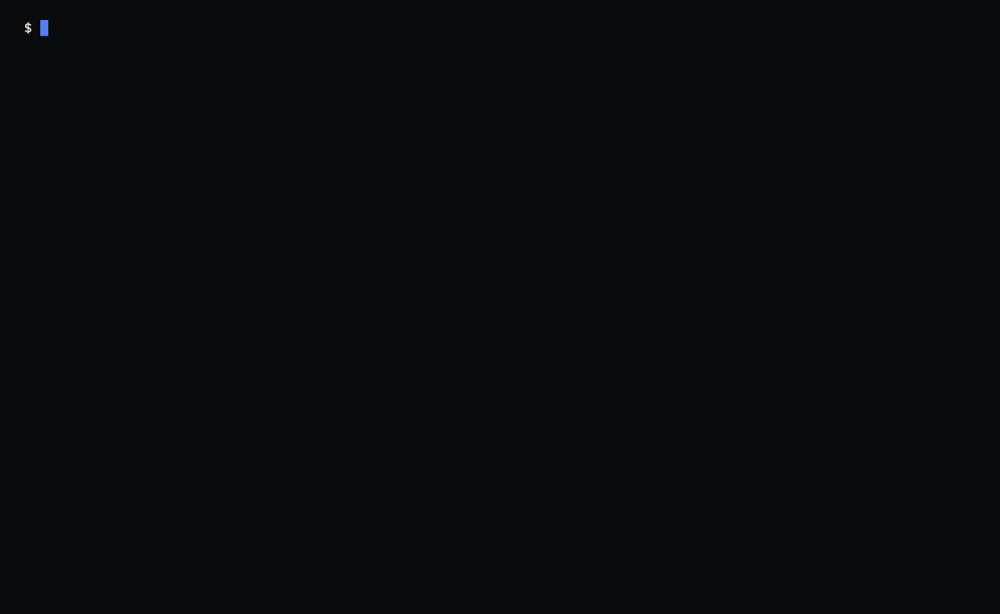
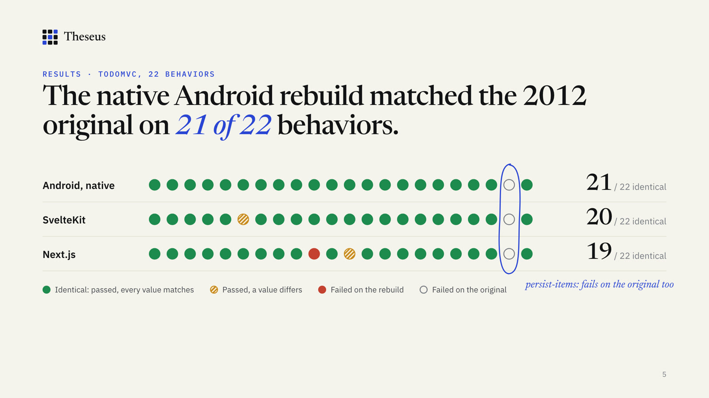
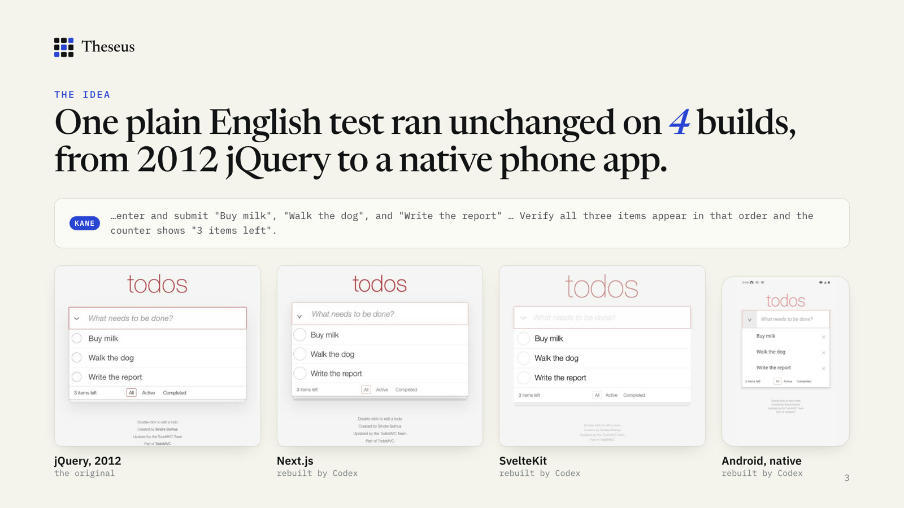
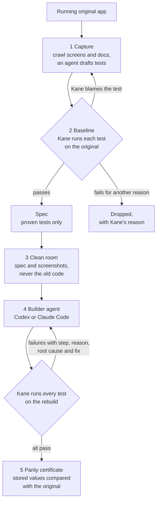
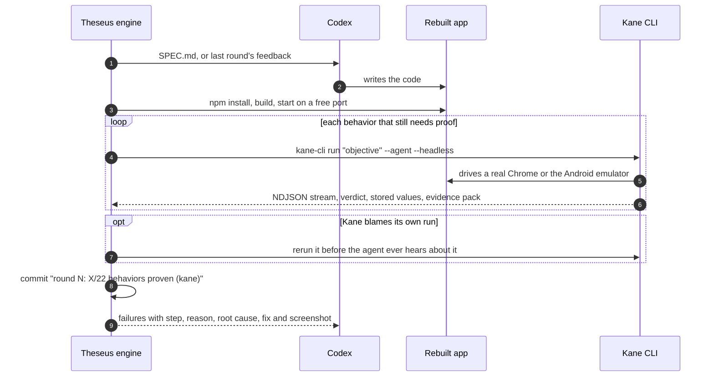
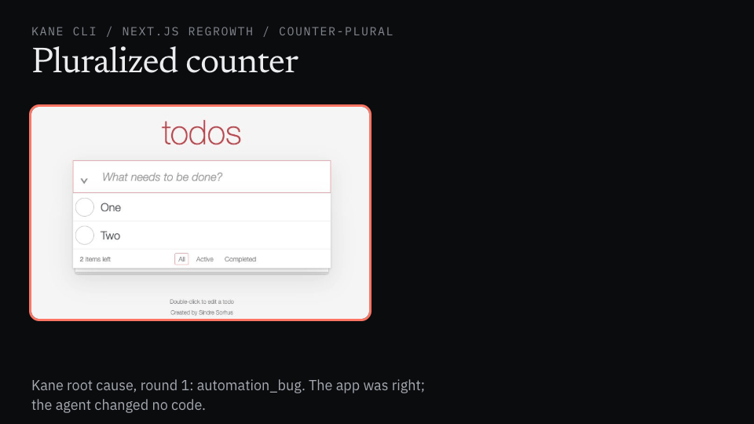
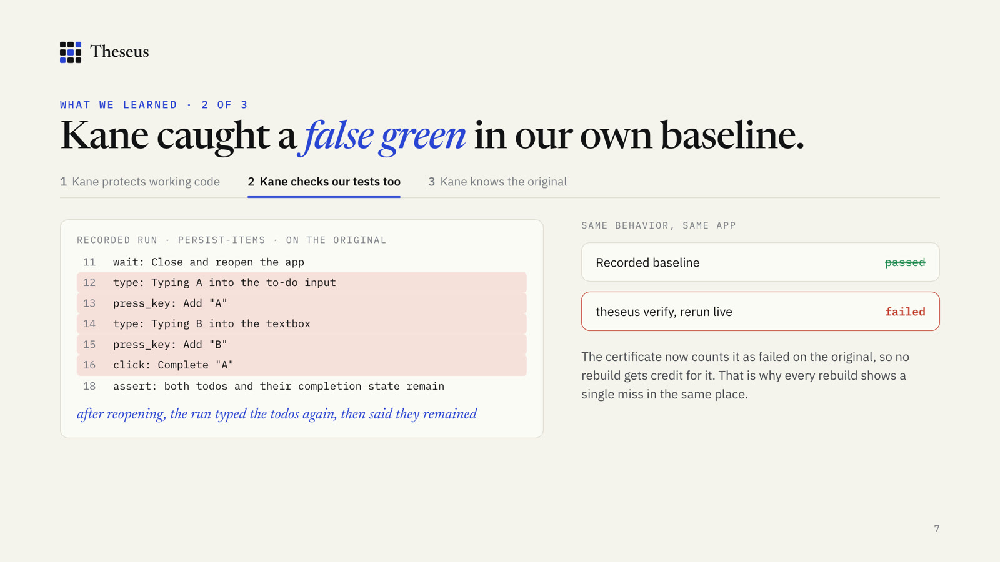
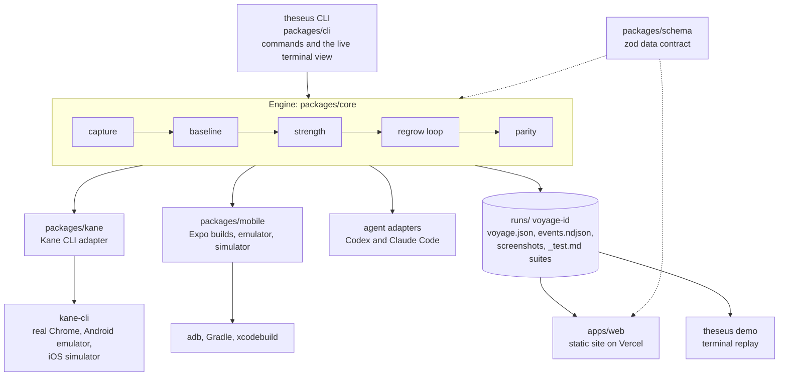

<div align="center">

# Theseus

### Delete an app's code. Get it back in any stack, even as a native Android app.<br>Kane CLI proves it still behaves the same.

[](https://github.com/Adwaitbytes/theseus/actions/workflows/ci.yml)
[](#development)
[](https://github.com/LambdaTest/kane-cli)
[](LICENSE)

**[Live site](https://theseus-umber.vercel.app)** · **[4 minute demo](https://youtu.be/J3EE_QQQbhg)** · **[Certificates](https://theseus-umber.vercel.app/voyages/todomvc-jquery)** · **[Deck (PDF)](launch/deck/Theseus-deck.pdf)**



</div>

Theseus watches a running app, writes down what it does as plain English tests, and keeps only the tests that [Kane CLI](https://github.com/LambdaTest/kane-cli) can prove on the original. Then it throws the code away. An AI coding agent (OpenAI Codex) rebuilds the app from those tests alone, in a folder that never contains the old source, while Kane checks every behavior on every rebuild in a real browser or on the Android emulator. Whatever fails goes back to the agent with Kane's own diagnosis, round after round, until Kane agrees. At the end you get a certificate that compares the exact values Kane read on the original with the values it read on each rebuild.

The name comes from the old riddle of the Ship of Theseus: if you replace every plank of a ship, is it still the same ship? Theseus answers that question for software, with evidence instead of opinion.

Built for the [KaneCLI Online Hackathon](https://www.kaneclihack.sh) by TestMu AI.

---

## Contents

- [Results at a glance](#results-at-a-glance)
- [If you are judging](#if-you-are-judging)
- [Why this exists](#why-this-exists)
- [How it works](#how-it-works)
- [One round, up close](#one-round-up-close)
- [What Kane caught](#what-kane-caught)
- [Architecture](#architecture)
- [How Theseus uses Kane CLI](#how-theseus-uses-kane-cli)
- [Quick start](#quick-start)
- [Commands](#commands)
- [Configuration](#configuration)
- [FAQ](#faq)
- [Honest limits](#honest-limits)
- [Repository map](#repository-map)
- [Development](#development)

---

## Results at a glance

The main test subject is the classic jQuery [TodoMVC](https://todomvc.com) from 2012, vendored unchanged with its MIT license. Theseus captured 22 behaviors from it: adding, editing, completing, filtering, clearing and saving todos. Every rebuild below was written by OpenAI Codex from those 22 sentences, without ever seeing the original source.

| Rebuild | Kane proved | Identical to the original | Rounds | Kane credits | Try it |
|---|---|---|---|---|---|
| **Native Android app** (Expo, on the emulator) | 21 of 22 | **21 of 22** | 1 | 501 | [Kane's screenshots](runs/todomvc-jquery/artifacts/expo-android) |
| **SvelteKit** | 22 of 22 | 20 of 22 | 1 | 491 | [live](https://theseus-todomvc-sveltekit.vercel.app) |
| **Next.js** | 21 of 22 | 19 of 22 | 6 | 1,165 | [live](https://theseus-todomvc-nextjs.vercel.app) |
| **RealWorld Conduit**, AngularJS to Next.js, full stack | 14 of 16 | 13 of 16 | 2 | 479 | [certificate](https://theseus-umber.vercel.app/voyages/realworld-angularjs) |

You can compare the rebuilds with [the original jQuery app, live](https://theseus-todomvc-original.vercel.app). Kane re-ran a behavior against each deployed web rebuild at its public URL, and both held.



**How to read a certificate.** Each behavior on each rebuild gets one of four verdicts:

| Verdict | What it means |
|---|---|
| Identical | Kane passed it on the rebuild, and every value Kane stored (counter text, visible titles and so on) matches what it read on the original |
| Diverged | Kane passed it, but at least one stored value is different, so a human should look |
| Failed on the rebuild | Kane failed it on the rebuild after the last round |
| Failed on the original | The behavior does not hold on the original either, so no rebuild gets credit for it |

Every number here comes from the recorded runs in [`runs/`](runs). Nothing is estimated.

---

## If you are judging

| Bar or dimension | Where to look |
|---|---|
| Works end to end | Live apps: [jQuery original](https://theseus-todomvc-original.vercel.app), [Next.js](https://theseus-todomvc-nextjs.vercel.app), [SvelteKit](https://theseus-todomvc-sveltekit.vercel.app). Certificates and round by round replays on [theseus-umber.vercel.app](https://theseus-umber.vercel.app). A replay that needs no accounts: `theseus demo runs/todomvc-jquery` |
| Kane caught or proved something | Kane exposed a false green in our own baseline ([video, 0:58](https://youtu.be/J3EE_QQQbhg?t=58)), and every certificate cell is a Kane run you can inspect in [`runs/`](runs) |
| Agent and Kane talked | Kane's failing step, reason, root cause and fix go back to Codex every round ([video, 1:43](https://youtu.be/J3EE_QQQbhg?t=103)). Each round is a commit, listed in [`ROUNDS.md`](examples/todomvc-jquery/regrown/nextjs/ROUNDS.md) |
| Ships | Native Android 21 of 22 identical, SvelteKit 20, Next.js 19, RealWorld full stack 13 of 16 ([video, 3:02](https://youtu.be/J3EE_QQQbhg?t=182)) |
| Verified | Kane proves every spec behavior on the original before anything is rebuilt, and a failure Kane blames on its own run is rerun instead of being sent to the agent |
| Closed loop | [Next.js, round by round](https://theseus-umber.vercel.app/voyages/todomvc-jquery/nextjs), plus [a real feedback message](#one-round-up-close) below |
| Craft | `theseus regrow`, `verify`, `suite`, `doctor` and `demo`, 289 passing tests, and the [regrown source code](examples/todomvc-jquery/regrown) |

---

## Why this exists

Rewriting software is where behavior quietly changes. A counter that used to say "1 item left" starts saying "1 items left", or saved data disappears after a reload, and nobody notices until a user does. AI coding agents make rewrites cheap, which makes the problem bigger: the agent writes the code, reads its own summary, and declares itself done.

Most tests cannot help, because they are welded to the code they check. A Playwright test that clicks `#todo-list li .toggle` breaks the moment the markup changes, so it tells you nothing about whether a rewrite kept the behavior.

A Kane CLI test is different. It describes what a person does and what they should see, in plain English, and Kane works out the clicks in a real browser or on a phone. That sentence does not care whether the app is jQuery, SvelteKit or a native Android app, so one test can judge the original and every rebuild. Theseus is built on that single idea. If tests written as intent survive a rewrite, they are the real source code of a product, and the code becomes something you can grow back.



---

## How it works



1. **Capture.** Theseus crawls the running original with Playwright, saving each screen, its interactive states and a screenshot, and reads any docs you pass with `--docs`. A drafting agent turns all of that into platform neutral tests such as *"add a todo called Buy milk and store the footer counter text as 'counter_text'"*. The same sentence has to work in a browser and on a phone, so the drafting rules ban CSS selectors, URLs and framework names.

2. **Baseline.** Kane runs every draft against the original. Only what Kane proves there becomes the spec. When a draft fails and Kane's root cause analysis says the test was at fault (`automation_bug`), the drafting agent rewrites it from Kane's suggested fix and Kane runs it again. Anything that still fails is dropped, with Kane's reason saved.

3. **Clean room.** For each target stack Theseus creates an empty git repository holding only `SPEC.md` (the proven tests, grouped by area, plus a short brief for the stack) and the reference screenshots. The original source never enters this folder.

4. **Regrow.** The builder agent builds the app. Theseus installs it, starts it on a free port (or compiles a release build and installs it on the emulator), and Kane runs every behavior. Failures go back to the agent with the failing step, Kane's reason, its root cause, its suggested fix and the screenshot. Later rounds rerun only what failed, and once everything has passed, one final full pass checks that nothing regressed. Each round is a git commit.

5. **Parity.** Theseus compares the values Kane stored on the original with the values it stored on each rebuild, behavior by behavior, and writes the certificate. It also exports each rebuild's spec as committed Kane `_test.md` files, so the proof can be rerun later with `theseus suite`.

There is also an optional **strength** phase that plants realistic bugs in a copy of the original and scores how many the spec catches. It is fully implemented, but it was not run for the published voyages, so this README makes no claims about it.

---

## One round, up close



This is what Codex actually received at the start of round 2 of the Next.js rebuild, trimmed only for length:

```text
Round 2. Kane CLI ran the behaviors from SPEC.md against your app: 20 of 22 pass.

Fix the app so these behaviors pass, without breaking the ones that already pass. When
Kane's root cause is an automation_bug the app may be right and the test flaky; check the
screenshot before changing working code.

### Fresh empty view (`fresh-empty`)

Failed at step 4: assert: no todo items, counter, filters, or clear-completed action are shown
Root cause (automation_bug): The final verification expected each "absent" condition to be
false, even though an empty fresh todo page should make those conditions true. The
screenshots also show the empty page with no todo row, footer counter, filters, or clear action.
Suggested fix: Fix the empty-state assertion to expect todo_items_absent, counter_absent,
filters_absent, and clear_completed_action_absent to be true.
Screenshot of the failure: .theseus-feedback/round-2/fresh-empty.png
```

Codex read that, checked the screenshot, and changed nothing, because Kane itself said the app was right. That is the loop working as intended.

<p align="center"></p>

---

## What Kane caught

### 1. A false green in our own baseline

The behavior *"todos survive reopening the app"* had passed on the original. When we re-ran it with `theseus verify`, it failed. The recorded run showed why: after reopening the app, Kane's run had typed the todos in again and then reported that they were still there. The certificate now counts that behavior as failed on the original, so no rebuild gets credit for it, which is why every rebuild shows one miss in the same place.



### 2. Kane kept the agent from breaking working code

On the Next.js rebuild, Kane's own root cause analysis said several red results were slips in its own run, not bugs in the app (*"the screenshots show the app correctly displayed one item after the first add and two items after the second add"*). Codex changed **0 files** across the five follow-up rounds. Theseus now reruns failures like that before the agent ever sees them.

### 3. Kane knew the original better than our draft

For the RealWorld app, 21 behaviors were drafted and Kane kept 16. Two of the five it rejected were real limits of the 2012 app that our draft got wrong, and Kane labelled them `application_issue`: the article page never shows an article's description, and the settings form rejects hyphens in usernames.

### 4. An outdated dependency

Codex pinned Next.js 15.5.2, a version with a known vulnerability, and Vercel refused to deploy it. The live copy runs the patched 15.5.29, and the committed source is left exactly as Codex wrote it, so you can see what the agent actually produced.

---

## Architecture



Everything is TypeScript in strict mode, and every boundary (Kane's NDJSON, agent output, config files, files on disk) is validated with [zod](https://zod.dev) schemas from one shared package.

| Package | What it does | Key files |
|---|---|---|
| [`packages/schema`](packages/schema) | The data contract every other package and the website share: behaviors, Kane outcomes, rounds, parity reports, voyages and live events | `src/index.ts` |
| [`packages/kane`](packages/kane) | The only code that talks to `kane-cli`: builds commands, streams and parses NDJSON, maps exit codes, retries infrastructure failures, reads evidence packs, writes `_test.md` files and runs suites | `process.ts`, `ndjson.ts`, `outcome.ts`, `evidence.ts`, `testrun.ts` |
| [`packages/core`](packages/core) | The engine: the five phases, the agent adapters, the round loop, parity, resume, the budget guard and the event bus | `capture/`, `baseline.ts`, `regrow/loop.ts`, `parity.ts`, `voyage/index.ts` |
| [`packages/mobile`](packages/mobile) | Turns an Expo project into a standalone release build (APK for Android, a simulator `.app` zip for iOS), boots devices, installs and launches apps | `android.ts`, `expo.ts` |
| [`packages/cli`](packages/cli) | The `theseus` command, the Ink based live view, `doctor`, `verify`, `suite` and `demo` | `program.ts`, `commands.ts`, `tui/` |
| [`apps/web`](apps/web) | The website: a replayed voyage matrix, parity certificates, round by round pages and the method page, statically built from `runs/` | `app/`, `lib/replay.ts` |

### What a voyage leaves on disk

```text
runs/todomvc-jquery/
  voyage.json         the whole record: spec, baseline, every round of every rebuild, parity
  events.ndjson       every live event in order; the website and `theseus demo` replay it
  credits.json        the running Kane credit ledger
  artifacts/          Kane's screenshots per target, round and behavior
  spec/               the proven behaviors as committed Kane _test.md files, one folder per target
```

Kane's evidence packs are never committed, because they embed account details. Only the screenshots inside them are copied out, and a test checks that no email address or home folder path ever reaches `runs/`.

### Design decisions worth knowing

| Decision | Why | Where |
|---|---|---|
| A clean room per target | The agent must rebuild from the spec, not translate old code, or the certificate means nothing | `packages/core/src/regrow/index.ts` |
| Rerun before feedback | When Kane blames its own run, sending that to the agent invites it to "fix" working code | `packages/core/src/regrow/loop.ts` |
| Redraft from Kane's fix | A test that is wrong about the original should be repaired from Kane's own suggestion, then proven again | `packages/core/src/baseline.ts` |
| Resume from the event log | Kane runs cost credits, so a crash or closed laptop should never mean paying twice | `packages/core/src/resume.ts` |
| A cross process lock on `voyage.json` | Several `theseus regrow --target` processes can share one voyage without overwriting each other | `packages/core/src/voyage/index.ts` |
| Browser crashes are retried, never blamed | A dead Chrome says nothing about the app | `packages/kane/src/process.ts` |
| A seed reset before every run | Stateful apps (sign in, posts, comments) need every Kane run to start from the same data | `packages/core/src/state.ts` |
| An isolated Codex home | Other tools editing `~/.codex/config.toml` must not break a build halfway through | `packages/core/src/agents/codex-home.ts` |
| A credit budget guard | Each phase and round is estimated and refused if it would exceed `budgetCredits` | `packages/core/src/kane/budget.ts` |
| Replay only the certified attempt | The website and `theseus demo` show what the certificate counts, not aborted attempts | `packages/core/src/events/certified.ts` |

---

## How Theseus uses Kane CLI

Kane is not a test step bolted on at the end. It decides what goes into the spec, it is the agent's eyes every round, and it supplies the values the certificate compares.

| Kane CLI feature | What Theseus does with it | Code |
|---|---|---|
| `kane-cli run --agent` and its NDJSON stream | Runs every behavior check and streams each step into the live view and the replay | `packages/kane/src/process.ts`, `ndjson.ts` |
| Exit codes (0 pass, 1 fail, 2 setup, 3 timeout) | Infrastructure errors are retried with backoff and never counted against the app | `packages/kane/src/process.ts` |
| Root cause triage in evidence packs | Separates test slips (`automation_bug`) from real app problems (`application_issue`) to decide what reaches the agent | `packages/kane/src/evidence.ts`, `packages/core/src/regrow/loop.ts` |
| Stored values (`final_state`) | The exact counter texts, titles and states the parity certificate compares | `packages/kane/src/outcome.ts`, `packages/core/src/parity.ts` |
| Evidence pack screenshots | A screenshot behind every certificate cell, and the image the agent sees with each failure | `packages/kane/src/evidence.ts` |
| `--target emulator` and `--target simulator` | The same sentences drive the native Expo rebuild on the Android emulator | `packages/kane/src/command.ts` |
| `_test.md` export and `kane-cli testrun run` | Each rebuild ships a committed Kane suite that `theseus suite` and CI can rerun | `packages/kane/src/testmd.ts`, `testrun.ts` |
| `kane-cli balance` | `theseus doctor` and the budget guard check credits before spending them | `packages/kane/src/client.ts` |

---

## Quick start

### Watch a recorded voyage (no accounts needed)

You need Node 24 or newer and pnpm.

```sh
git clone https://github.com/Adwaitbytes/theseus && cd theseus
pnpm install && pnpm build
alias theseus="node $PWD/packages/cli/dist/index.js"

theseus demo runs/todomvc-jquery
```

This replays the real TodoMVC voyage in the live terminal view, exactly as it was recorded, and ends on the parity certificate.

### Rebuild your own app

You also need Kane CLI signed in, and Codex or Claude Code. For the Android target you need the Android SDK and an emulator, and for iOS you need Xcode.

```sh
npm install -g @testmuai/kane-cli
kane-cli login --oauth

theseus doctor
theseus regrow http://localhost:3000 --to nextjs,expo-android --agent codex --budget 3000
```

`theseus doctor` checks Node, your Kane sign in and credit balance, Codex, Claude Code, the Android emulator and the iOS simulator, and tells you how to fix anything missing. `theseus regrow` saves its config under `.theseus/configs/`, so running the same command again picks up where it stopped.

Stacks you can regrow into: `nextjs`, `sveltekit`, `nuxt`, `react-router`, `vite-react`, `angular`, `expo-android` and `expo-ios`.

---

## Commands

| Command | What it does |
|---|---|
| `theseus regrow <url> --to <stacks>` | Runs the whole voyage against a running app: capture, baseline, strength, regrow and parity |
| `theseus regrow <url> --to nextjs --race codex,claude-code` | Rebuilds the same stack once per agent and compares them |
| `theseus init <url> --to <stacks>` | Writes the config `regrow` would use, so you can review and edit it first |
| `theseus voyage <config>` | Runs every phase from a config file, resuming where it stopped |
| `theseus capture`, `baseline`, `strength`, `parity` | Runs a single phase |
| `theseus verify <run> --behavior <id> --target <id>` | Re-proves one certificate cell live with Kane and shows the recorded and fresh results side by side |
| `theseus suite <run> --target <id>` | Runs a rebuild's committed `_test.md` suite with `kane-cli testrun` |
| `theseus demo [run]` | Replays a recorded voyage in the live view, with no credentials needed |
| `theseus doctor` | Checks everything a voyage needs |
| `theseus serve <dir>` | Serves a static original, such as TodoMVC, on localhost |

Every command supports `--help` with examples, and `--json` prints machine readable NDJSON instead of the live view.

---

## Configuration

`theseus regrow <url>` writes a config for you, and you can also write one by hand. This is the one behind the TodoMVC voyage, trimmed:

```json
{
  "id": "todomvc-jquery",
  "title": "jQuery TodoMVC, regrown",
  "app": { "name": "TodoMVC", "description": "Add, edit, complete, filter and clear todos." },
  "original": { "label": "jQuery TodoMVC (2012)", "stack": "jQuery 2, Handlebars, Director", "url": "http://localhost:4170" },
  "docs": ["docs/todomvc-app-spec.md"],
  "targets": [
    { "id": "nextjs", "label": "Next.js", "platform": "web", "stack": "Next.js (App Router, TypeScript)", "agent": "codex" },
    { "id": "expo-android", "label": "Expo on Android", "platform": "android", "stack": "Expo (React Native, TypeScript)", "agent": "codex" }
  ],
  "rounds": 5,
  "budgetCredits": 11200,
  "draftAgent": { "agent": "codex" }
}
```

| Field | Meaning | Default |
|---|---|---|
| `original.url` | Where the running original lives | required |
| `docs` | Extra documents for the drafting agent | none |
| `targets[]` | The stacks to rebuild into: `platform` is `web`, `android` or `ios`, and `agent` is `codex` or `claude-code` | required |
| `rounds` | How many build and verify rounds each target gets | 5 |
| `budgetCredits` | A hard cap on Kane credits for the whole voyage | none |
| `concurrency.web` | Kane runs in parallel on web targets | 2 |
| `strength.enabled` | Whether to run the planted bug phase | true |
| `kane.timeoutS` | Our own wall clock limit per Kane run | 300 |

### Apps that keep data on a server

If the original has a backend (sign in, posts, comments), add a `state` block. Before every Kane run, Theseus calls the reset route to restore a known seed, runs web checks one at a time so they never see each other's writes, and puts the seed and the reset contract into every clean room so each rebuild ships them too.

```json
"state": { "resetUrl": "/__theseus/reset", "method": "POST", "seedDoc": "seed/SEED.md" }
```

The RealWorld example in [`examples/realworld-angularjs`](examples/realworld-angularjs) shows this end to end.

---

## FAQ

<details>
<summary><b>Does the agent ever see the original code?</b></summary>

No. Each clean room holds only `SPEC.md` and the reference screenshots. The agent can install packages from npm, and TodoMVC is famous enough that a model may simply know it, so the certificate never relies on the agent's honesty: it relies on Kane running every behavior on the result. The rebuilt code is committed in [`examples/todomvc-jquery/regrown`](examples/todomvc-jquery/regrown) for anyone to compare.
</details>

<details>
<summary><b>Does "identical" prove the two apps are the same?</b></summary>

It proves they behave the same on every behavior the spec captured, with the same values on screen. It does not cover behavior nobody wrote down, which is why capture aims to cover the whole app and why the strength phase exists to measure how much the spec would catch.
</details>

<details>
<summary><b>Why Kane CLI and not Playwright?</b></summary>

Playwright tests address elements by selectors that belong to one codebase, so they die in a rewrite and cannot run on a native app at all. Kane reads plain English intent and drives a browser or a phone itself, so one test can judge jQuery, SvelteKit and Android alike. Kane also explains its failures with a root cause and a suggested fix, which is what makes the feedback loop useful to an agent.
</details>

<details>
<summary><b>What does it cost?</b></summary>

A Kane check took about 89 seconds and about 25 credits on average on the TodoMVC original. The whole TodoMVC voyage, the baseline plus three rebuilds, used 2,696 Kane credits, and the native Android rebuild alone used 501.
</details>

<details>
<summary><b>Can I use Claude Code instead of Codex?</b></summary>

Yes. Pass `--agent claude-code`, or `--race codex,claude-code` to rebuild the same stack with both and compare them. The published voyages used Codex.
</details>

<details>
<summary><b>What about iOS?</b></summary>

The pipeline supports it: `packages/mobile` builds a simulator release and Kane's iOS simulator tooling is set up. The iOS rebuild did not finish before the deadline, so there are no iOS results to show.
</details>

---

## Honest limits

- **One Kane quirk counts against us.** On Next.js, `counter-plural` kept failing because the run compared placeholder names instead of the values it had stored. Kane's own root cause says the app is right, and the certificate still marks it as failed.
- **Two values diverged on the web rebuilds.** On Next.js, Kane's reading of the counter on `filter-active` picked up the whole footer, because the markup is structured differently. On SvelteKit, the counter value was not stored on `trim-input`.
- **The iOS rebuild did not finish** in time, and **RealWorld stopped at 14 of 16** without a final fix round.
- **The strength phase** is implemented and tested but was not run for these voyages.
- **It costs credits and time.** Each behavior check is a real browser or emulator session of about a minute and a half.

---

## Repository map

```text
packages/
  schema/      zod data contract shared by everything
  kane/        Kane CLI adapter
  core/        the engine: phases, round loop, agents, parity, resume
  mobile/      Expo release builds, emulator and simulator control
  cli/         the theseus command and its live view
apps/
  web/         the website at theseus-umber.vercel.app
examples/
  todomvc-jquery/        the 2012 original, its docs, and the regrown Next.js, SvelteKit and Android source
  realworld-angularjs/   the AngularJS Conduit original, its seeded backend and reset contract
runs/          every recorded voyage: the evidence behind every number
launch/        demo video, deck, posts and submission text
docs/          plan, mobile notes, README images
```

---

## Development

```sh
pnpm install
pnpm build        # builds every package
pnpm test         # 289 tests across schema, kane, core, mobile, cli and web
pnpm typecheck
pnpm lint
```

| Package | Tests |
|---|---|
| core | 114 |
| mobile | 69 |
| kane | 62 |
| cli | 32 |
| web | 12 |

CI runs install, typecheck, lint, test and build on every push, and a second workflow reruns a rebuild's committed Kane suite when Kane credentials are configured as repository secrets.

---

## Credits and license

Theseus is MIT licensed. The vendored originals keep their own MIT licenses: [TodoMVC](https://github.com/tastejs/todomvc) by the TodoMVC team, and the [RealWorld](https://github.com/gothinkster/realworld) AngularJS frontend and Node backend from the gothinkster organization. The upstream commits are recorded in each `UPSTREAM` file.

Built with [Kane CLI](https://github.com/LambdaTest/kane-cli) by TestMu AI and OpenAI Codex.
