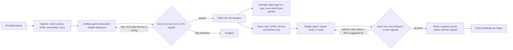

# Theseus

**Delete an app's code and it grows back in any stack, including native mobile, while Kane CLI proves every behavior still matches the original.**

[Live site]({{SITE_URL}}) · [4 minute demo]({{DEMO_VIDEO_URL}}) · [Parity certificate]({{SITE_URL}}/voyages/todomvc-jquery) · [Method]({{SITE_URL}}/method) · [Blog post]({{DEVTO_URL}}) · [Deck]({{DECK_URL}})


Theseus captures what a running app does as plain-English Kane CLI tests, keeps only the ones Kane proves on the original, deletes the code, and has coding agents rebuild it from that spec alone. Kane tests every rebuild, sends its failures back to the agent, and repeats until every behavior passes. At the end you get a parity certificate that compares the exact values Kane read on the original with the values it read on each rebuild.

On the 2012 jQuery TodoMVC, Theseus kept {{TODOMVC_BEHAVIORS}} behaviors, caught {{BUGS_CAUGHT}} of {{BUGS_PLANTED}} planted bugs, and regrew the app into Next.js in {{NEXTJS_ROUNDS}} rounds, SvelteKit in {{SVELTEKIT_ROUNDS}}, Expo on Android in {{EXPO_ANDROID_ROUNDS}} and Expo on iOS in {{EXPO_IOS_ROUNDS}}, for {{TOTAL_KANE_CREDITS}} Kane credits in total.

## Quickstart (60 seconds)

You need Node 22 or newer. `regrow` also needs [Kane CLI]({{KANE_CLI_URL}}) signed in, plus Claude Code or Codex. `demo` needs none of that.

```sh
# 1. Check Node, Kane sign-in and credits, Claude Code, Codex, the Android emulator and the iOS simulator
npx theseus-cli doctor

# 2. Regrow the app running on port 3000 into Next.js and a native Expo app on the Android emulator
npx theseus-cli regrow http://localhost:3000 --to nextjs,expo-android

# 3. No credentials? Replay the recorded TodoMVC voyage in the live terminal view
npx theseus-cli demo
```

`regrow` runs the whole voyage (capture, baseline, strength, regrow, parity) and saves a config under `.theseus/configs/`, so running the same command again resumes where it stopped. Useful flags:

```sh
npx theseus-cli regrow http://localhost:3000 --to nextjs --race codex,claude-code --budget 3000
npx theseus-cli regrow http://localhost:3000 --to sveltekit --agent codex --docs docs/spec.md --rounds 5
npx theseus-cli verify runs/todomvc-jquery --behavior add-todo --target nextjs
npx theseus-cli suite runs/todomvc-jquery --target nextjs --parallel 4
```

Supported stacks: `nextjs`, `sveltekit`, `nuxt`, `react-router`, `vite-react`, `angular`, `expo-android`, `expo-ios`. Builder agents: `claude-code` (default) and `codex`.

## How it works



1. **Capture.** Theseus crawls the running original and any docs you pass with `--docs`. A drafting agent turns what it saw into platform-neutral objectives such as "Add a todo called Alpha, mark it complete, and store the counter text as items_left". Each objective is written so the same sentence can drive a browser, an Android emulator or an iOS simulator.
2. **Baseline.** Kane runs every draft against the original. Only behaviors Kane proves there survive. When Kane's root-cause analysis blames the test rather than the app (`automation_bug`), the drafting agent rewrites the test with Kane's suggested fix and Kane runs it again. On TodoMVC, {{TODOMVC_DRAFTED}} drafts became {{TODOMVC_BEHAVIORS}} proven behaviors, and {{TESTS_REPAIRED_BY_RCA}} of them were repaired this way.
3. **Strength.** Theseus plants realistic bugs in a copy of the original (an off-by-one counter, a missing trim, a swapped filter, a dropped storage write) and records which behaviors fail. The score is the share of planted bugs at least one behavior catches: {{BUGS_CAUGHT}} of {{BUGS_PLANTED}} on TodoMVC. A bug nothing catches is listed on the certificate with its patch.
4. **Regrow.** Each target starts in an empty directory holding `SPEC.md` and reference screenshots. The original source is never in the workspace, the prompt or the feedback. The agent builds, Theseus starts the app, Kane runs every behavior, and the failures go back. This repeats until green or until the round cap.
5. **Parity.** Every behavior runs once more on the original and on each finished regrowth. A behavior is `identical` when both pass and every value Kane stored is equal, and `diverged` when both pass but a stored value differs. Divergences are printed, never rounded away.

## The Kane loop

The loop is the product. Every round, for every behavior that failed, the builder agent receives exactly what Kane reported:

```text
behavior   {{LOOP_EXAMPLE_BEHAVIOR}}
step       {{LOOP_EXAMPLE_STEP}}
reason     {{LOOP_EXAMPLE_REASON}}
root cause {{LOOP_EXAMPLE_ROOT_CAUSE}}
fix        {{LOOP_EXAMPLE_SUGGESTED_FIX}}
evidence   runs/todomvc-jquery/artifacts/{{LOOP_EXAMPLE_SCREENSHOT}}
```

The agent never sees Theseus's opinion of the app, only Kane's account of what happened in the running app. Because Kane classifies each failure, the loop can route it: product bugs go to the builder, test bugs (`automation_bug`) go back to the drafting agent, and infrastructure failures (exit code 2) are retried and never blamed on the build. Across the TodoMVC voyage Kane sent {{KANE_FAILURES_FED_BACK}} failures back to builders over {{TOTAL_KANE_RUNS}} runs.

## Every Kane feature Theseus uses, and why

| Kane CLI feature | What Theseus does with it |
|---|---|
| `kane-cli run --agent` NDJSON stream | Parses every step event live to drive the terminal view and the event log the site is built from. |
| `--mode testing` | Gets a pass or fail verdict per behavior instead of an open-ended session. |
| `--target desktop`, `emulator`, `simulator` with `--url`, `--app`, `--device-name`, `--os-version` | Runs the same plain-English objective on the web original, the web regrowths, the Android `.apk` and the iOS simulator `.app`. |
| `--headless`, `--timeout`, `--max-steps` | Keeps web runs cheap and bounded. Theseus also enforces its own wall clock and kills the process group. |
| Stored values (`final_state`) | Every behavior declares keys to store, such as `items_left`. Parity compares those values between original and regrowth. |
| Verdict RCA (`root_cause`, `family`, `suggestion`) | Feeds the builder agent, and separates `automation_bug` (repair the test) from product bugs (repair the app). |
| Evidence packs (`failure.yaml`, annotated screenshots, `kane-cli evidence serve`) | Copies the failing screenshot and the final screenshot into the run so every certificate cell links to proof. |
| `_test.md` export and `kane-cli testrun run --agent` | Each target's spec is committed as Kane test files. `theseus suite` reruns them as one Kane suite, in CI too, without Theseus driving each behavior. |
| Exit codes 0, 1, 2, 3 | 2 means infrastructure, so Theseus retries with backoff instead of failing the round. |
| `kane-cli balance`, `whoami`, `--version` | `doctor` checks sign-in and credits, `--budget` enforces a hard credit cap, and every voyage records the Kane version ({{KANE_CLI_VERSION}}) for provenance. |

## Results

Hero voyage: the 2012 jQuery TodoMVC (jQuery 2, Handlebars, Director). Stretch voyage: the AngularJS RealWorld Conduit app, a full-stack app on an end-of-life framework.

| Voyage | Target | Builder | Rounds to green | Identical | Diverged | Kane credits |
|---|---|---|---|---|---|---|
| TodoMVC | Next.js | {{NEXTJS_AGENT}} | {{NEXTJS_ROUNDS}} | {{NEXTJS_IDENTICAL}} | {{NEXTJS_DIVERGED}} | {{NEXTJS_CREDITS}} |
| TodoMVC | SvelteKit | {{SVELTEKIT_AGENT}} | {{SVELTEKIT_ROUNDS}} | {{SVELTEKIT_IDENTICAL}} | {{SVELTEKIT_DIVERGED}} | {{SVELTEKIT_CREDITS}} |
| TodoMVC | Expo on Android | {{EXPO_ANDROID_AGENT}} | {{EXPO_ANDROID_ROUNDS}} | {{EXPO_ANDROID_IDENTICAL}} | {{EXPO_ANDROID_DIVERGED}} | {{EXPO_ANDROID_CREDITS}} |
| TodoMVC | Expo on iOS | {{EXPO_IOS_AGENT}} | {{EXPO_IOS_ROUNDS}} | {{EXPO_IOS_IDENTICAL}} | {{EXPO_IOS_DIVERGED}} | {{EXPO_IOS_CREDITS}} |
| Conduit | {{CONDUIT_TARGET}} | {{CONDUIT_AGENT}} | {{CONDUIT_ROUNDS}} | {{CONDUIT_IDENTICAL}} | {{CONDUIT_DIVERGED}} | {{CONDUIT_CREDITS}} |

Spec strength on TodoMVC: {{BUGS_CAUGHT}} of {{BUGS_PLANTED}} planted bugs caught ({{STRENGTH_SCORE}}). Surviving bug: {{SURVIVING_MUTANT}}.

Agent race on {{RACE_STACK}}: Codex reached green in {{RACE_CODEX_ROUNDS}} rounds for {{RACE_CODEX_CREDITS}} credits, Claude Code in {{RACE_CLAUDE_ROUNDS}} rounds for {{RACE_CLAUDE_CREDITS}} credits. Winner: {{RACE_WINNER}}. The ranking is green first, then fewer rounds, then more identical behaviors, then fewer credits.

Every number above is read from the committed files under `runs/`. The site is built from the same files and fails its build if any of them does not match the schema.

## Methodology and honest limitations

The full version is on the [method page]({{SITE_URL}}/method). The short version:

- **Parity is not equivalence.** It covers the behaviors in the spec and nothing else. Performance, accessibility, visual detail beyond what Kane checks and rare timing are untested by construction.
- **Kane is an AI agent operating a real interface.** A pass is strong evidence, not a formal proof. Theseus narrows the gap by requiring every behavior to pass on the original first and by keeping the evidence pack for every run.
- **The spec is only as good as its strength score.** {{BUGS_CAUGHT}} of {{BUGS_PLANTED}} means {{BUGS_SURVIVED}} realistic bugs would slip through. They are listed, not hidden.
- **Agents can overfit to feedback,** for example by special-casing a test string. Read the parity result together with the round history, which is committed.
- **Clean room means no source, not no knowledge.** The builder cannot read the original code, but the model may know TodoMVC from training. That is why the second voyage is a full-stack Conduit app with a custom seed.
- **Mobile is slower.** Emulator and simulator runs go one at a time, so a mobile round costs more wall clock ({{EXPO_ANDROID_ROUND_MINUTES}} minutes per Android round on TodoMVC).
- **Platform conventions can conflict with the original.** Escape to cancel an edit has no direct Android equivalent. When the agent's choice fails the objective, the certificate says so. Example divergence: {{EXAMPLE_DIVERGENCE}}.
- **It costs credits.** The TodoMVC voyage used {{TOTAL_KANE_CREDITS}} Kane credits over {{TOTAL_KANE_RUNS}} runs. Every voyage page shows its own cost.

## Repo map

```text
packages/schema    zod contract shared by everything (Behavior, Target, Round, ParityReport, Voyage, events)
packages/kane      Kane CLI adapter: run, NDJSON parsing, evidence packs, _test.md export, testrun suites
packages/core      engine: capture, baseline, strength, regrow loop, parity, race, agent adapters, event bus
packages/mobile    Expo toolchain: build the .apk and the simulator .app, boot devices, install
packages/cli       the `theseus` binary (npm: theseus-cli), commander plus an Ink live view, and `theseus demo`
apps/web           Next.js site built from committed runs: story, replay, certificates, method
examples/          originals and their docs: todomvc-jquery, realworld-angularjs
runs/<voyage-id>   committed artifacts: voyage.json, events.ndjson, screenshots, exported _test.md suites
```

Develop locally with `pnpm install && pnpm build && pnpm test`.

## Credits and licenses

- [TodoMVC jQuery example](https://github.com/tastejs/todomvc) by the TodoMVC contributors, MIT. Vendored in `examples/todomvc-jquery/original`.
- [AngularJS RealWorld example app](https://github.com/gothinkster/angularjs-realworld-example-app) and [Moleculer RealWorld backend](https://github.com/gothinkster/moleculer-node-realworld-example-app) by the RealWorld contributors, MIT. Vendored in `examples/realworld-angularjs/original`.
- [Kane CLI]({{KANE_CLI_URL}}) by TestMu AI does the testing, the root-cause analysis and the evidence.
- Theseus itself: {{THESEUS_LICENSE}}.

## Hackathon note

Theseus was built for the [KaneCLI Online Hackathon by TestMu AI]({{HACKATHON_URL}}), November 2026. Kane CLI sits at every stage of the pipeline: it decides which behaviors exist, scores the spec, grades every round and writes the feedback the agents act on, and its stored values are the basis of the parity certificate.
